# Roadmap

```mermaid
flowchart LR
    S0["S0: setup, ADRs, SQLite, migraciones, FPCUnit"] --> S1["S1: Login, usuarios, auditoría"]
    S1 --> S2["S2: Pacientes, consentimiento"]
    S2 --> S3["S3: Alergias, antecedentes, respaldos, inicio SOAP"]
    S3 --> S4["S4: SOAP, CIE-10, firma"]
    S4 --> R1(["Release 1.0: HC"])
    R1 --> S5["S5: Estadísticas núcleo + CSV, enmiendas"]
    S5 --> S6["S6: EPI-15, indicadores, PDF HC, habeas data"]
    S6 --> R2(["Release 1.1: Estadísticas"])
```

| Sprint | Objetivo | Historias |
|---|---|---|
| 0 | Base técnica | Capas, `TConexionSQLite` (PRAGMAs), migraciones `user_version`, FPCUnit, `IReloj`, HashLib4Pascal, decisión ADR-004 |
| 1 | Acceso seguro y trazable | Spec 001 (HU-001, 002, 022, 023) + Spec 003 núcleo (HU-003, 025, 026) |
| 2 | Identidad del paciente | Spec 002 (HU-004..006), HU-007, HU-024, anclas auditoría |
| 3 | Seguridad clínica | HU-008, HU-009, HU-019, inicio HU-010 |
| 4 | Consulta firmada | HU-010, HU-011, HU-012, HU-021 |
| 5 | Estadísticas núcleo | HU-030, 031, 032, 033, HU-013, HU-014 |
| 6 | Indicadores y reportes | HU-034, 035, 036, HU-018, HU-027 |
