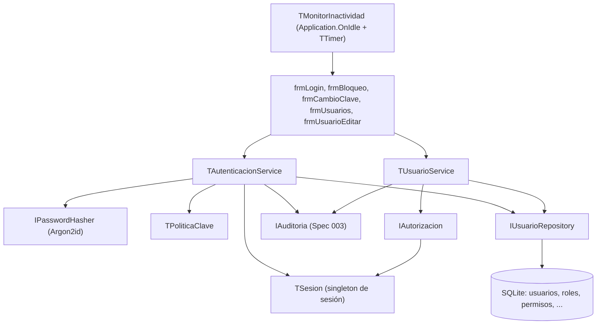

# Plan técnico 001 — Usuarios y Permisos

Ref: [spec.md](spec.md) · ADR-001 (SQLite), ADR-002 · Constitución Art. 2, 6

## 1. Arquitectura



## 2. Unidades

| Unidad | Contenido |
|---|---|
| `src/dominio/uUsuario.pas` | `TUsuario`, `TProfesional`, `TEstadoUsuario` |
| `src/dominio/uPermisos.pas` | Constantes de permisos (`PERM_HC_LEER = 'HC.LEER'`…), `TConjuntoPermisos` |
| `src/seguridad/uPasswordHasher.pas` | `IPasswordHasher`, `TArgon2Hasher` (HashLib4Pascal), comparación tiempo constante |
| `src/seguridad/uPoliticaClave.pas` | Reglas RF-001-03 → lista de incumplimientos |
| `src/seguridad/uSesion.pas` | `TSesion`: usuario, roles, permisos (caché), equipo, inicio, último uso |
| `src/seguridad/uAutorizacion.pas` | `IAutorizacion.Tiene(perm)`, `Exigir(perm)` → `EAccesoDenegado` + auditoría |
| `src/servicios/uAutenticacionService.pas` | `Login`, `Logout`, `CambiarClave`, `CambiarPIN`, `VerificarPIN`, `Desbloquear` |
| `src/servicios/uUsuarioService.pas` | `Crear`, `Actualizar`, `AsignarRoles`, `Inactivar`, `ResetearClave` |
| `src/servicios/uAccesoEmergenciaService.pas` | `Solicitar`, `Vigente(usuario, paciente)` |
| `src/datos/uUsuarioRepository.pas` | `IUsuarioRepository` + `TUsuarioRepositorySQLite` |
| `src/ui/ufrmLogin`, `ufrmBloqueo`, `ufrmCambioClave`, `ufrmUsuarios`, `ufrmUsuarioEditar`, `ufrmPrimerArranque` | Formularios |
| `src/ui/uMonitorInactividad.pas` | Detecta inactividad (`Application.AddOnUserInputHandler`) |
| `tests/TestPoliticaClave.pas`, `TestAutenticacion.pas`, `TestAutorizacion.pas` | FPCUnit |

## 3. Modelo de datos (SQLite STRICT)

```sql
CREATE TABLE usuarios (
  id                INTEGER PRIMARY KEY,
  login             TEXT    NOT NULL UNIQUE COLLATE NOCASE,
  cedula            TEXT    NOT NULL UNIQUE,           -- V-12345678 / E-...
  nombres           TEXT    NOT NULL,
  apellidos         TEXT    NOT NULL,
  email             TEXT,
  telefono          TEXT,
  clave_hash        TEXT    NOT NULL,                  -- formato PHC Argon2id
  clave_temporal    INTEGER NOT NULL DEFAULT 1 CHECK (clave_temporal IN (0,1)),
  clave_cambiada_utc TEXT,
  pin_hash          TEXT,
  estado            TEXT    NOT NULL DEFAULT 'A' CHECK (estado IN ('A','B','I')),
  bloqueado_hasta_utc TEXT,
  intentos_fallidos INTEGER NOT NULL DEFAULT 0,
  creado_utc        TEXT    NOT NULL,
  creado_por        INTEGER REFERENCES usuarios(id),   -- NULL solo para ADMIN inicial
  version           INTEGER NOT NULL DEFAULT 1,
  CHECK (cedula GLOB '[VE]-[0-9]*' AND length(cedula) BETWEEN 3 AND 11)
) STRICT;

CREATE TRIGGER tr_usuarios_no_delete
BEFORE DELETE ON usuarios
BEGIN
  SELECT RAISE(ABORT, 'Prohibido eliminar usuarios');
END;

CREATE TABLE profesionales (
  usuario_id     INTEGER PRIMARY KEY REFERENCES usuarios(id),
  tipo           TEXT NOT NULL,                        -- MEDICO, ENFERMERIA...
  mpps           TEXT NOT NULL UNIQUE,
  colegio        TEXT,
  nro_colegio    TEXT,
  especialidades TEXT
) STRICT;

CREATE TABLE claves_hist (
  id         INTEGER PRIMARY KEY,
  usuario_id INTEGER NOT NULL REFERENCES usuarios(id),
  clave_hash TEXT    NOT NULL,
  creado_utc TEXT    NOT NULL
) STRICT;

CREATE TABLE roles (
  codigo  TEXT PRIMARY KEY,
  nombre  TEXT NOT NULL,
  sistema INTEGER NOT NULL DEFAULT 0 CHECK (sistema IN (0,1))
) STRICT, WITHOUT ROWID;

CREATE TABLE permisos (
  codigo      TEXT PRIMARY KEY,
  descripcion TEXT NOT NULL
) STRICT, WITHOUT ROWID;

CREATE TABLE rol_permisos (
  rol     TEXT NOT NULL REFERENCES roles(codigo),
  permiso TEXT NOT NULL REFERENCES permisos(codigo),
  PRIMARY KEY (rol, permiso)
) STRICT, WITHOUT ROWID;

CREATE TABLE usuario_roles (
  usuario_id INTEGER NOT NULL REFERENCES usuarios(id),
  rol        TEXT    NOT NULL REFERENCES roles(codigo),
  PRIMARY KEY (usuario_id, rol)
) STRICT, WITHOUT ROWID;

CREATE TABLE roles_incompatibles (
  rol_a TEXT NOT NULL REFERENCES roles(codigo),
  rol_b TEXT NOT NULL REFERENCES roles(codigo),
  PRIMARY KEY (rol_a, rol_b)
) STRICT, WITHOUT ROWID;

CREATE TABLE sesiones (
  id         INTEGER PRIMARY KEY,
  usuario_id INTEGER NOT NULL REFERENCES usuarios(id),
  equipo     TEXT    NOT NULL,
  ip         TEXT,
  inicio_utc TEXT    NOT NULL,
  fin_utc    TEXT,
  motivo_fin TEXT
) STRICT;

CREATE TABLE accesos_emergencia (
  id           INTEGER PRIMARY KEY,
  usuario_id   INTEGER NOT NULL REFERENCES usuarios(id),
  paciente_id  INTEGER NOT NULL,
  motivo       TEXT    NOT NULL CHECK (length(motivo) >= 20),
  inicio_utc   TEXT    NOT NULL,
  expira_utc   TEXT    NOT NULL,
  revisado_por INTEGER REFERENCES usuarios(id),
  revisado_utc TEXT,
  dictamen     TEXT
) STRICT;
```

## 4. Seed matriz rol–permiso (`001_seed_roles.sql`)

| Permiso | ADMIN | MEDICO | ENFERMERIA | RECEPCION | ESTADISTICA | AUDITOR | DIR_MED |
|---|---|---|---|---|---|---|---|
| USUARIO.GESTIONAR / ROL.GESTIONAR | ✔ | | | | | | |
| CATALOGO.GESTIONAR / RESPALDO.EJECUTAR | ✔ | | | | | | |
| PACIENTE.LEER | | ✔ | ✔ | ✔ | | | ✔ |
| PACIENTE.CREAR / EDITAR | | ✔ | | ✔ | | | |
| PACIENTE.CAMBIAR_ESTADO | | ✔ | | ✔ | | | ✔ |
| PACIENTE.FUSIONAR | | | | | | | ✔ |
| HC.LEER | | ✔ | ✔ | | | | ✔ |
| HC.ESCRIBIR / HC.FIRMAR / HC.ENMENDAR | | ✔ | ✔ | | | | |
| HC.IMPRIMIR / HC.EXPORTAR | | ✔ | | | | | ✔ |
| HC.ACCESO_EMERGENCIA | | ✔ | | | | | |
| ESTADISTICA.VER / EXPORTAR | | | | | ✔ | | ✔ |
| ESTADISTICA.VER_PROPIA | | ✔ | | | | | |
| AUDITORIA.LEER / EXPORTAR | | | | | | ✔ | ✔ (solo leer) |

Incompatibles: `(ADMIN, AUDITOR)`.

## 5. Decisiones
- Permisos cargados al login en `TSesion`.
- `IAutorizacion.Exigir` en primera línea de cada método público de servicio.
- Fechas ISO-8601 UTC (`YYYY-MM-DDTHH:NN:SS.ZZZZ`); display `America/Caracas`.
- Comparación de hash en tiempo constante.

## 6. Pruebas
- Unitarias: política de clave, hasher, bloqueo con `IReloj`, matriz rol×permiso, incompatibilidad de roles.
- Integración SQLite (`:memory:`): repositorio, trigger `tr_usuarios_no_delete`, constraint `GLOB` de cédula.
- Seguridad: check CI sin `CLAVE`/`PIN` en logs.
