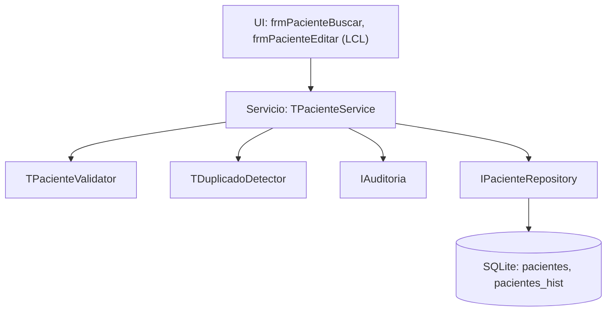

# Plan técnico 002 — Pacientes

Ref: [spec.md](spec.md) · ADR-001 (SQLite) · Constitución Art. 3, 6, 7

## 1. Arquitectura (capas)



## 2. Unidades Pascal

| Unidad | Contenido |
|---|---|
| `src/dominio/uPaciente.pas` | `TPaciente`, enums `TTipoDocumento`, `TSexo`, `TEstadoPaciente` |
| `src/dominio/uPacienteValidator.pas` | Reglas RF-002-01/04, RN-1..3 → `TResultadoValidacion` |
| `src/servicios/uPacienteService.pas` | `Registrar`, `Buscar`, `Actualizar`, `CambiarEstado` |
| `src/servicios/uDuplicadoDetector.pas` | Normaliza texto (sin acentos, minúsculas) + compara |
| `src/datos/uPacienteRepository.pas` | `IPacienteRepository` + `TPacienteRepositorySQLite` |
| `src/ui/ufrmPacienteBuscar.pas/.lfm` | Grilla resultados (`TStringGrid`), búsqueda incremental |
| `src/ui/ufrmPacienteEditar.pas/.lfm` | Formulario alta/edición |
| `tests/TestPacienteService.pas` | FPCUnit con repositorio en memoria / SQLite `:memory:` |

## 3. Modelo de datos (SQLite STRICT)

```sql
CREATE TABLE secuencias (
  nombre TEXT PRIMARY KEY,
  valor  INTEGER NOT NULL
) STRICT, WITHOUT ROWID;
INSERT INTO secuencias VALUES ('HC', 0);

CREATE TABLE pacientes (
  id              INTEGER PRIMARY KEY,
  nro_hc          TEXT    NOT NULL UNIQUE,
  tipo_doc        TEXT    NOT NULL CHECK (tipo_doc IN ('V','E','P','M','NN')),
  nro_doc         TEXT    NOT NULL,
  nombres         TEXT    NOT NULL,
  apellido1       TEXT    NOT NULL,
  apellido2       TEXT,
  nombre_busq     TEXT    NOT NULL,                    -- normalizado sin acentos, minúsculas
  fecha_nac       TEXT    NOT NULL,                    -- 'YYYY-MM-DD'
  sexo            TEXT    NOT NULL CHECK (sexo IN ('M','F','I')),
  genero          TEXT,
  estado_civil    TEXT,
  ocupacion       TEXT,
  direccion       TEXT,
  telefono1       TEXT,
  telefono2       TEXT,
  email           TEXT,
  grupo_sang      TEXT,
  contacto_emerg  TEXT,
  aseguradora     TEXT,
  representante_id INTEGER REFERENCES pacientes(id),   -- LOPNNA: menor sin cédula
  estado          TEXT    NOT NULL DEFAULT 'A' CHECK (estado IN ('A','I','F')),
  fecha_fallec    TEXT,
  sin_documento   INTEGER NOT NULL DEFAULT 0 CHECK (sin_documento IN (0,1)),
  creado_utc      TEXT    NOT NULL,
  creado_por      INTEGER NOT NULL REFERENCES usuarios(id),
  version         INTEGER NOT NULL DEFAULT 1,
  UNIQUE (tipo_doc, nro_doc),
  CHECK (fecha_fallec IS NULL OR fecha_fallec >= fecha_nac)
) STRICT;

CREATE INDEX ix_pac_nombre ON pacientes(nombre_busq);
CREATE INDEX ix_pac_fnac   ON pacientes(fecha_nac);
CREATE INDEX ix_pac_doc    ON pacientes(nro_doc);

CREATE TRIGGER tr_pacientes_no_delete
BEFORE DELETE ON pacientes
BEGIN
  SELECT RAISE(ABORT, 'Prohibido eliminar pacientes');
END;

CREATE TABLE pacientes_hist (
  id          INTEGER PRIMARY KEY,
  paciente_id INTEGER NOT NULL REFERENCES pacientes(id),
  version     INTEGER NOT NULL,
  datos_json  TEXT    NOT NULL,
  motivo      TEXT    NOT NULL,
  modif_utc   TEXT    NOT NULL,
  modif_por   INTEGER NOT NULL REFERENCES usuarios(id)
) STRICT;
```

## 4. Decisiones
- Normalización en Pascal (`NormalizarTexto`) guardada en `nombre_busq` → búsqueda con `LIKE :prefijo || '%'` o `INSTR` indexada.
- Nro HC: en `BEGIN IMMEDIATE`, `UPDATE secuencias SET valor = valor + 1 WHERE nombre = 'HC' RETURNING valor` → `HC-AAAA-NNNNNN`.
- Si cambia `fecha_nac` o `sexo` de paciente con consultas firmadas, actualiza snapshot (`edad_anios`, `edad_meses`, `sexo`) en `consultas` dentro de la misma transacción y audita `CONSULTA_SNAPSHOT_RECALCULO`.

## 5. Pruebas
- Unitarias: validator, detector duplicados, service.
- Integración SQLite `:memory:`: repositorio, trigger no-delete, unicidad documento.
- Rendimiento: seed 100 000 pacientes en archivo SQLite en HDD → búsqueda < 1 s (RNF-01).
