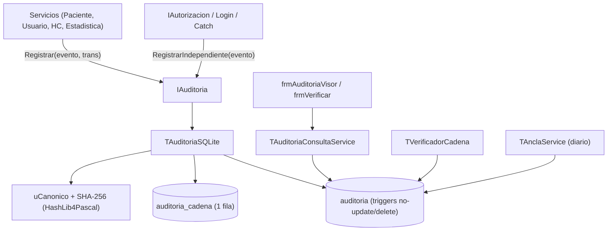

# Plan técnico 003 — Auditoría

Ref: [spec.md](spec.md) · ADR-001 (SQLite), ADR-003 · Constitución Art. 3

## 1. Arquitectura



## 2. Unidades

| Unidad | Contenido |
|---|---|
| `src/auditoria/uEventoAuditoria.pas` | `TEventoAuditoria`, constantes (`AUD_LOGIN_OK`…), `TResultadoAud` |
| `src/auditoria/uAuditoria.pas` | `IAuditoria`: `Registrar(const E; ATrans)`, `RegistrarIndependiente(const E)` |
| `src/auditoria/uAuditoriaSQLite.pas` | Implementación SQLite; lee `auditoria_cadena`, calcula SHA-256, inserta |
| `src/auditoria/uDiffJson.pas` | JSON antes/después solo con campos cambiados; lista negra (`CLAVE*`, `PIN*`) |
| `src/auditoria/uCanonico.pas` | Serialización canónica determinista + `CalcularHashEvento` |
| `src/auditoria/uVerificadorCadena.pas` | Recalcula hashes, detecta huecos, compara anclas |
| `src/auditoria/uAnclaService.pas` | Exporta ancla diaria firmada con HMAC |
| `src/servicios/uAuditoriaConsultaService.pas` | Filtros, paginado keyset, exportar CSV/JSON, informe habeas data |
| `src/ui/ufrmAuditoriaVisor`, `ufrmAuditoriaDetalle`, `ufrmVerificarCadena` | UI |
| `tests/TestDiffJson.pas`, `TestCanonico.pas`, `TestVerificador.pas`, `TestAuditoriaSQLite.pas` | FPCUnit |
| `tests/doubles/uAuditoriaMemoria.pas` | Doble en memoria para tests de otros servicios |

## 3. Modelo de datos (SQLite STRICT)

```sql
CREATE TABLE auditoria (
  seq         INTEGER PRIMARY KEY,
  fecha_utc   TEXT    NOT NULL,                 -- 'YYYY-MM-DDTHH:NN:SS.ZZZZ'
  usuario_id  INTEGER,
  login_txt   TEXT,
  roles       TEXT,
  sesion_id   INTEGER,
  equipo      TEXT,
  ip          TEXT,
  accion      TEXT    NOT NULL,
  entidad     TEXT,
  entidad_id  TEXT,
  paciente_id INTEGER,
  resultado   TEXT    NOT NULL CHECK (resultado IN ('O','D','E')),
  motivo      TEXT,
  datos       TEXT,                             -- JSON {antes:{}, despues:{}}
  hash_datos  TEXT,                             -- SHA-256 hex lowercase (64)
  hash_prev   TEXT    NOT NULL CHECK (length(hash_prev) = 64),
  hash        TEXT    NOT NULL CHECK (length(hash) = 64)
) STRICT;

CREATE INDEX ix_aud_fecha    ON auditoria(fecha_utc);
CREATE INDEX ix_aud_usuario  ON auditoria(usuario_id, seq DESC);
CREATE INDEX ix_aud_paciente ON auditoria(paciente_id, seq DESC);
CREATE INDEX ix_aud_accion   ON auditoria(accion, seq DESC);

CREATE TABLE auditoria_cadena (
  id          INTEGER PRIMARY KEY CHECK (id = 1),
  ultimo_seq  INTEGER NOT NULL,
  ultimo_hash TEXT    NOT NULL CHECK (length(ultimo_hash) = 64),
  ultima_fecha_utc TEXT NOT NULL
) STRICT;

CREATE TABLE auditoria_anclas (
  fecha   TEXT PRIMARY KEY,
  seq     INTEGER NOT NULL,
  hash    TEXT    NOT NULL,
  destino TEXT
) STRICT, WITHOUT ROWID;

-- Inmutabilidad y validación de cadena en BD
CREATE TRIGGER tr_aud_no_update
BEFORE UPDATE ON auditoria
BEGIN
  SELECT RAISE(ABORT, 'Registro de auditoria inmutable');
END;

CREATE TRIGGER tr_aud_no_delete
BEFORE DELETE ON auditoria
BEGIN
  SELECT RAISE(ABORT, 'Registro de auditoria inmutable');
END;

CREATE TRIGGER tr_aud_check_chain
BEFORE INSERT ON auditoria
BEGIN
  SELECT CASE
    WHEN NEW.seq <> (SELECT ultimo_seq + 1 FROM auditoria_cadena WHERE id = 1)
      THEN RAISE(ABORT, 'Secuencia de auditoria invalida')
    WHEN NEW.hash_prev <> (SELECT ultimo_hash FROM auditoria_cadena WHERE id = 1)
      THEN RAISE(ABORT, 'Hash previo de auditoria invalido')
  END;
END;

CREATE TRIGGER tr_aud_advance_chain
AFTER INSERT ON auditoria
BEGIN
  UPDATE auditoria_cadena
     SET ultimo_seq = NEW.seq,
         ultimo_hash = NEW.hash,
         ultima_fecha_utc = NEW.fecha_utc
   WHERE id = 1;
END;
```

## 4. Serialización canónica (`uCanonico.pas`)

Un solo código Pascal usado tanto al insertar como al verificar (elimina riesgo de discrepancia SQL vs Pascal):

```
canon = IntToStr(Seq) + '|' + FechaUtc + '|' + IntToStrVacio(UsuarioId) + '|' +
        LoginTxt + '|' + Accion + '|' + Entidad + '|' + EntidadId + '|' +
        IntToStrVacio(PacienteId) + '|' + Resultado + '|' +
        EscaparPipe(Motivo) + '|' + HashDatos + '|' + HashPrev
hash  = LowerCase(SHA256Hex(UTF8Encode(canon)))
```

## 5. Patrón transaccional en SQLite

```pascal
FAutorizacion.Exigir(PERM_PACIENTE_EDITAR); // si falla → RegistrarIndependiente(ACCESO_DENEGADO)
Conexion.ExecuteDirect('BEGIN IMMEDIATE');
try
  FRepo.Actualizar(Pac);
  FAuditoria.Registrar(Evento);             // lee auditoria_cadena, calcula hash, INSERT
  Conexion.ExecuteDirect('COMMIT');
except
  on E: Exception do
  begin
    Conexion.ExecuteDirect('ROLLBACK');
    FAuditoria.RegistrarIndependiente(EventoError(E)); // su propio BEGIN IMMEDIATE .. COMMIT
    raise;
  end;
end;
```

## 6. Pruebas
- Unitarias: `uDiffJson`, `uCanonico`, `TVerificadorCadena` (cadena íntegra, alterada, hueco, ancla discrepante).
- Integración SQLite (`:memory:`): inserción encadenada, triggers `tr_aud_no_update`/`tr_aud_no_delete`/`tr_aud_check_chain`, registro independiente tras rollback, detección de retroceso de reloj.
- Rendimiento: seed 1 M eventos en archivo SQLite → filtro < 2 s, verificación < 3 min.
