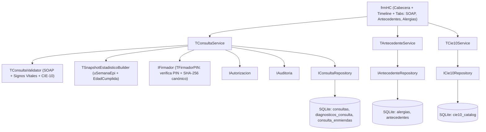
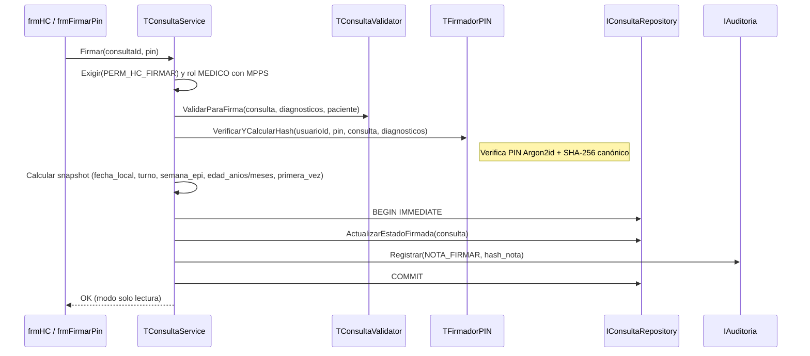

# Plan técnico 004 — Historia Clínica SOAP, Antecedentes, CIE-10 y Firma

Ref: [spec.md](spec.md) · [Spec 005 plan](../005-estadisticas/plan.md) · ADR-001..003 · Constitución Art. 1, 3, 4, 6, 8, 10

## 1. Arquitectura



## 2. Unidades Pascal

| Unidad | Contenido |
|---|---|
| `src/dominio/uConsulta.pas` | `TConsulta`, `TSignosVitales`, `TDiagnosticoConsulta`, `TEnmienda`, enums `TEstadoConsulta`, `TTipoCaso`, `TCertezaDx` |
| `src/dominio/uAntecedente.pas` | `TAlergia`, `TAntecedente`, `TSeccionGineco`, enums de categoría/severidad |
| `src/dominio/uCie10.pas` | `TCie10Item` |
| `src/dominio/uConsultaValidator.pas` | Rangos fisiológicos RF-004-07, cálculo IMC, reglas de firma (≥1 dx, 1 principal, coherencia sexo/edad) |
| `src/seguridad/uFirmador.pas` | `IFirmador`, `TFirmadorPIN` (valida PIN vía `TAutenticacionService.VerificarPIN`, genera string canónico de la nota y calcula SHA-256) |
| `src/servicios/uConsultaService.pas` | `IniciarBorrador`, `GuardarBorrador`, `Firmar`, `AnularBorrador`, `AgregarEnmienda`, `ListarTimeline`, `ObtenerDetalle` |
| `src/servicios/uAntecedenteService.pas` | `MarcarEstadoAlergias`, `RegistrarAlergia`, `InactivarAlergia`, `RegistrarAntecedente`, `CambiarEstadoAntecedente` |
| `src/servicios/uCie10Service.pas` | `Buscar(texto, sexoPaciente, edadAnios, medicoId)`, `ImportarCSV(archivo)` |
| `src/datos/uConsultaRepository.pas` | `IConsultaRepository` + `TConsultaRepositorySQLite` |
| `src/datos/uAntecedenteRepository.pas` | `IAntecedenteRepository` + `TAntecedenteRepositorySQLite` |
| `src/datos/uCie10Repository.pas` | `ICie10Repository` + `TCie10RepositorySQLite` |
| `src/ui/ufrmHistoriaClinica.pas/.lfm` | Ventana principal de HC: cabecera fija, timeline lateral, pestañas SOAP / Antecedentes / Alergias, timer autoguardado 30 s |
| `src/ui/ufrmBuscadorCie10.pas/.lfm` | Diálogo rápido por teclado (Flechas + Enter) para selección de diagnóstico |
| `src/ui/ufrmFirmarPin.pas/.lfm` | Diálogo modal para solicitar PIN al firmar consulta o enmienda |
| `src/ui/ufrmEnmienda.pas/.lfm` | Diálogo para redactar y firmar enmienda |
| `tests/TestConsultaValidator.pas`, `TestConsultaService.pas`, `TestCie10Service.pas`, `TestInmutabilidadHC.pas` | FPCUnit |

## 3. Modelo de datos (SQLite STRICT)

> Cumple íntegramente el contrato exigido por Spec 005 (`consultas`, `diagnosticos_consulta`, `cie10_catalog`).

```sql
-- Estado global de evaluación de alergias en tabla pacientes (migración 004 agrega columna):
-- ALTER TABLE pacientes ADD COLUMN estado_alergias TEXT NOT NULL DEFAULT 'NO_EVALUADO'
--   CHECK (estado_alergias IN ('NO_EVALUADO','SIN_ALERGIAS','CON_ALERGIAS'));

CREATE TABLE alergias (
  id             INTEGER PRIMARY KEY,
  paciente_id    INTEGER NOT NULL REFERENCES pacientes(id),
  categoria      TEXT    NOT NULL CHECK (categoria IN ('MEDICAMENTO','ALIMENTO','AMBIENTAL','OTRO')),
  sustancia      TEXT    NOT NULL,
  reaccion       TEXT    NOT NULL,
  severidad      TEXT    NOT NULL CHECK (severidad IN ('LEVE','MODERADA','SEVERA')),
  estado         TEXT    NOT NULL DEFAULT 'A' CHECK (estado IN ('A','I')),
  motivo_inact   TEXT,
  creado_utc     TEXT    NOT NULL,
  creado_por     INTEGER NOT NULL REFERENCES usuarios(id),
  inactivado_utc TEXT,
  inactivado_por INTEGER REFERENCES usuarios(id)
) STRICT;
CREATE INDEX ix_alergias_pac ON alergias(paciente_id, estado);

CREATE TRIGGER tr_alergias_no_delete
BEFORE DELETE ON alergias
BEGIN
  SELECT RAISE(ABORT, 'Prohibido eliminar alergias');
END;

CREATE TABLE antecedentes (
  id             INTEGER PRIMARY KEY,
  paciente_id    INTEGER NOT NULL REFERENCES pacientes(id),
  categoria      TEXT    NOT NULL CHECK (categoria IN (
                   'PERSONAL_PATOLOGICO','FAMILIAR','QUIRURGICO_TRAUMATICO',
                   'GINECO_OBSTETRICO','HABITO')),
  cie10_codigo   TEXT    REFERENCES cie10_catalog(codigo),
  descripcion    TEXT    NOT NULL,
  detalle_json   TEXT,                           -- ej. parentesco, año, G/P/A/C/FUM
  estado         TEXT    NOT NULL DEFAULT 'ACTIVO' CHECK (estado IN ('ACTIVO','RESUELTO','INACTIVO')),
  motivo_cambio  TEXT,
  creado_utc     TEXT    NOT NULL,
  creado_por     INTEGER NOT NULL REFERENCES usuarios(id),
  modif_utc      TEXT,
  modif_por      INTEGER REFERENCES usuarios(id)
) STRICT;
CREATE INDEX ix_antecedentes_pac ON antecedentes(paciente_id, categoria, estado);

CREATE TRIGGER tr_antecedentes_no_delete
BEFORE DELETE ON antecedentes
BEGIN
  SELECT RAISE(ABORT, 'Prohibido eliminar antecedentes');
END;

CREATE TABLE cie10_catalog (
  codigo         TEXT PRIMARY KEY,               -- 'J00', 'R50.9'
  descripcion    TEXT NOT NULL,
  capitulo       TEXT NOT NULL,
  grupo          TEXT,
  sexo_aplica    TEXT CHECK (sexo_aplica IN ('M','F')),
  edad_min_anios INTEGER,
  edad_max_anios INTEGER,
  activo         INTEGER NOT NULL DEFAULT 1 CHECK (activo IN (0,1)),
  busqueda       TEXT NOT NULL                   -- codigo + ' ' + descripcion normalizada sin acentos
) STRICT, WITHOUT ROWID;
CREATE INDEX ix_cie10_busq ON cie10_catalog(busqueda);

CREATE TABLE consultas (
  id                 INTEGER PRIMARY KEY,
  paciente_id        INTEGER NOT NULL REFERENCES pacientes(id),
  medico_id          INTEGER NOT NULL REFERENCES usuarios(id),
  creado_por         INTEGER NOT NULL REFERENCES usuarios(id), -- puede ser enfermería (triaje)
  especialidad       TEXT    NOT NULL,
  inicio_utc         TEXT    NOT NULL,
  -- Snapshot estadístico (calculado al crear y recalculado definitivo al firmar)
  fecha_local        TEXT    NOT NULL,           -- 'YYYY-MM-DD' America/Caracas
  turno              TEXT    NOT NULL CHECK (turno IN ('M','T','N')),
  anio_epi           INTEGER NOT NULL,
  semana_epi         INTEGER NOT NULL CHECK (semana_epi BETWEEN 1 AND 53),
  sexo               TEXT    NOT NULL CHECK (sexo IN ('M','F','I')),
  edad_anios         INTEGER NOT NULL CHECK (edad_anios BETWEEN 0 AND 130),
  edad_meses         INTEGER NOT NULL CHECK (edad_meses BETWEEN 0 AND 11),
  primera_vez        INTEGER NOT NULL CHECK (primera_vez IN (0,1)),
  -- Signos vitales (O)
  pa_sistolica       INTEGER CHECK (pa_sistolica BETWEEN 40 AND 300),
  pa_diastolica      INTEGER CHECK (pa_diastolica BETWEEN 20 AND 200),
  fc_lpm             INTEGER CHECK (fc_lpm BETWEEN 20 AND 260),
  fr_rpm             INTEGER CHECK (fr_rpm BETWEEN 4 AND 80),
  temp_c             REAL    CHECK (temp_c BETWEEN 30.0 AND 44.0),
  spo2_pct           INTEGER CHECK (spo2_pct BETWEEN 50 AND 100),
  peso_kg            REAL    CHECK (peso_kg BETWEEN 0.3 AND 350.0),
  talla_cm           REAL    CHECK (talla_cm BETWEEN 20.0 AND 250.0),
  imc                REAL,
  glucemia_mgdl      INTEGER CHECK (glucemia_mgdl BETWEEN 10 AND 800),
  -- Secciones SOAP
  motivo_consulta    TEXT    NOT NULL DEFAULT '', -- S
  enfermedad_actual  TEXT    NOT NULL DEFAULT '', -- S
  examen_fisico      TEXT    NOT NULL DEFAULT '', -- O
  analisis           TEXT    NOT NULL DEFAULT '', -- A
  plan_tratamiento   TEXT    NOT NULL DEFAULT '', -- P (conducta e indicaciones, sin récipe)
  -- Estado y Firma
  estado             TEXT    NOT NULL DEFAULT 'B' CHECK (estado IN ('B','F','A')),
  motivo_anulacion   TEXT,
  firmante_nombre    TEXT,
  firmante_cedula    TEXT,
  firmante_mpps      TEXT,
  firmante_colegio   TEXT,
  firmado_utc        TEXT,
  hash_nota          TEXT    CHECK (hash_nota IS NULL OR length(hash_nota) = 64),
  actualizado_utc    TEXT    NOT NULL,
  version            INTEGER NOT NULL DEFAULT 1,
  CHECK (pa_sistolica IS NULL OR pa_diastolica IS NULL OR pa_diastolica < pa_sistolica)
) STRICT;

CREATE INDEX ix_cons_paciente ON consultas(paciente_id, inicio_utc DESC);

CREATE TABLE diagnosticos_consulta (
  id           INTEGER PRIMARY KEY,
  consulta_id  INTEGER NOT NULL REFERENCES consultas(id),
  cie10_codigo TEXT    NOT NULL REFERENCES cie10_catalog(codigo),
  principal    INTEGER NOT NULL CHECK (principal IN (0,1)),
  tipo_caso    TEXT    NOT NULL CHECK (tipo_caso IN ('N','S')),
  certeza      TEXT    NOT NULL DEFAULT 'CONFIRMADO' CHECK (certeza IN ('PRESUNTIVO','CONFIRMADO')),
  nota         TEXT,
  orden        INTEGER NOT NULL,
  UNIQUE (consulta_id, cie10_codigo)
) STRICT;

CREATE UNIQUE INDEX ux_dx_principal ON diagnosticos_consulta(consulta_id) WHERE principal = 1;

CREATE TABLE consulta_enmiendas (
  id               INTEGER PRIMARY KEY,
  consulta_id      INTEGER NOT NULL REFERENCES consultas(id),
  medico_id        INTEGER NOT NULL REFERENCES usuarios(id),
  motivo           TEXT    NOT NULL CHECK (length(motivo) >= 10),
  contenido        TEXT    NOT NULL CHECK (length(contenido) > 0),
  firmante_nombre  TEXT    NOT NULL,
  firmante_mpps    TEXT    NOT NULL,
  firmante_colegio TEXT,
  creado_utc       TEXT    NOT NULL,
  hash_enmienda    TEXT    NOT NULL CHECK (length(hash_enmienda) = 64)
) STRICT;

CREATE INDEX ix_enmiendas_cons ON consulta_enmiendas(consulta_id, id);
```

### Triggers de Inmutabilidad Clínica

```sql
CREATE TRIGGER tr_consultas_no_delete
BEFORE DELETE ON consultas
BEGIN
  SELECT RAISE(ABORT, 'Prohibido eliminar consultas');
END;

-- Una vez firmada (OLD.estado = 'F') o anulada ('A'), ningún campo clínico puede cambiar.
-- Solo se permite actualizar snapshot demográfico (sexo, edad_anios, edad_meses) si se corrige ficha del paciente (Spec 002/005).
CREATE TRIGGER tr_consultas_inmutable
BEFORE UPDATE ON consultas
WHEN OLD.estado IN ('F','A') AND (
  NEW.estado <> OLD.estado OR
  NEW.paciente_id <> OLD.paciente_id OR
  NEW.medico_id <> OLD.medico_id OR
  NEW.motivo_consulta <> OLD.motivo_consulta OR
  NEW.enfermedad_actual <> OLD.enfermedad_actual OR
  NEW.examen_fisico <> OLD.examen_fisico OR
  NEW.analisis <> OLD.analisis OR
  NEW.plan_tratamiento <> OLD.plan_tratamiento OR
  COALESCE(NEW.pa_sistolica,-1) <> COALESCE(OLD.pa_sistolica,-1) OR
  COALESCE(NEW.pa_diastolica,-1) <> COALESCE(OLD.pa_diastolica,-1) OR
  COALESCE(NEW.fc_lpm,-1) <> COALESCE(OLD.fc_lpm,-1) OR
  COALESCE(NEW.fr_rpm,-1) <> COALESCE(OLD.fr_rpm,-1) OR
  COALESCE(NEW.temp_c,-1) <> COALESCE(OLD.temp_c,-1) OR
  COALESCE(NEW.spo2_pct,-1) <> COALESCE(OLD.spo2_pct,-1) OR
  COALESCE(NEW.peso_kg,-1) <> COALESCE(OLD.peso_kg,-1) OR
  COALESCE(NEW.talla_cm,-1) <> COALESCE(OLD.talla_cm,-1) OR
  COALESCE(NEW.hash_nota,'') <> COALESCE(OLD.hash_nota,'')
)
BEGIN
  SELECT RAISE(ABORT, 'Consulta firmada o anulada es inmutable');
END;

-- Prohibido agregar, editar o borrar diagnósticos de una consulta ya firmada o anulada
CREATE TRIGGER tr_dx_inmutable_ins
BEFORE INSERT ON diagnosticos_consulta
WHEN (SELECT estado FROM consultas WHERE id = NEW.consulta_id) <> 'B'
BEGIN
  SELECT RAISE(ABORT, 'No se pueden agregar diagnosticos a una consulta cerrada');
END;

CREATE TRIGGER tr_dx_inmutable_upd
BEFORE UPDATE ON diagnosticos_consulta
WHEN (SELECT estado FROM consultas WHERE id = OLD.consulta_id) <> 'B'
BEGIN
  SELECT RAISE(ABORT, 'No se pueden modificar diagnosticos de una consulta cerrada');
END;

CREATE TRIGGER tr_dx_inmutable_del
BEFORE DELETE ON diagnosticos_consulta
WHEN (SELECT estado FROM consultas WHERE id = OLD.consulta_id) <> 'B'
BEGIN
  SELECT RAISE(ABORT, 'No se pueden eliminar diagnosticos de una consulta cerrada');
END;

-- Enmiendas solo sobre consultas firmadas, y son inmutables desde su creación
CREATE TRIGGER tr_enmienda_solo_firmada
BEFORE INSERT ON consulta_enmiendas
WHEN (SELECT estado FROM consultas WHERE id = NEW.consulta_id) <> 'F'
BEGIN
  SELECT RAISE(ABORT, 'Solo se permiten enmiendas sobre consultas firmadas');
END;

CREATE TRIGGER tr_enmienda_inmutable_upd
BEFORE UPDATE ON consulta_enmiendas
BEGIN
  SELECT RAISE(ABORT, 'Enmienda es inmutable');
END;

CREATE TRIGGER tr_enmienda_inmutable_del
BEFORE DELETE ON consulta_enmiendas
BEGIN
  SELECT RAISE(ABORT, 'Enmienda es inmutable');
END;
```

## 4. Flujo de Firma (`TConsultaService.Firmar`)



## 5. Hash canónico de nota firmada (`uFirmador.pas`)
Concatenación determinista UTF-8 separada por `|`:
`id | paciente_id | medico_id | firmante_mpps | firmado_utc | signos_vitales_canon | motivo_consulta | enfermedad_actual | examen_fisico | analisis | plan_tratamiento | lista_dx_ordenada(codigo:principal:tipo_caso:certeza)`.
Permite demostrar que ni el texto SOAP ni los diagnósticos ni la autoría fueron alterados tras la firma.

## 6. Pruebas
- Unitarias: `TConsultaValidator` (rangos vitales, IMC, diastólica < sistólica, reglas CIE-10 sexo/edad, mínimo 1 dx principal), `TFirmadorPIN` (hash determinista, PIN incorrecto rechaza).
- Integración SQLite (`:memory:`):
  - Ciclo completo borrador → autoguardado → firma → intento de `UPDATE` en `consultas` o `DELETE` en `diagnosticos_consulta` abortado por triggers.
  - Enmienda sobre borrador rechazada; sobre firmada aceptada e inmutable.
  - Sugerencia `tipo_caso = 'S'` cuando existe consulta firmada previa con mismo código CIE-10.
  - Buscador CIE-10 con 14 000 códigos cargados en `:memory:` / disco < 50 ms.

