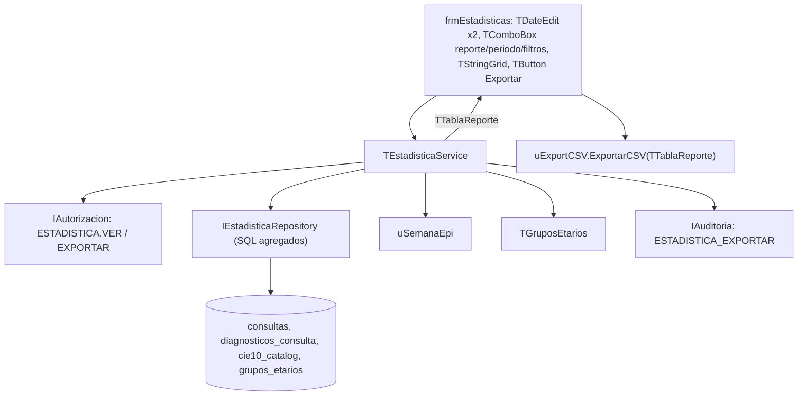

# Plan técnico 005 — Estadísticas

Ref: [spec.md](spec.md) · ADR-001 (SQLite) · Constitución Art. 6, 10

## 1. Arquitectura



Principio: SQL y reglas en servicio/repositorio; formulario solo pinta `TTablaReporte` en `TStringGrid` y llama exportador. **Se usa `TStringGrid` (no `TDBGrid`)**: resultado desacoplado del dataset, se cierra la consulta al terminar (menos memoria), testeable sin UI.

## 2. Unidades

| Unidad | Contenido |
|---|---|
| `src/estadisticas/uTablaReporte.pas` | `TTablaReporte` (columnas tipadas, filas, totales) |
| `src/estadisticas/uSemanaEpi.pas` | `SemanaEpi(Fecha): TSemanaEpi`, `RangoSemanaEpi(Anio, Semana): TRangoFechas` |
| `src/estadisticas/uGruposEtarios.pas` | Carga conjunto, `GrupoDe(EdadDias)` |
| `src/estadisticas/uFiltroEstadistica.pas` | `TFiltroEstadistica` (desde, hasta, médico, especialidad, turno, soloPrincipal, tipoCaso, topN) |
| `src/datos/uEstadisticaRepository.pas` | `IEstadisticaRepository` + `TEstadisticaRepositorySQLite` |
| `src/servicios/uEstadisticaService.pas` | `Morbilidad`, `Demografia`, `Volumen`, `Epi15`, `Indicadores`, `Tendencia`, `Exportar` |
| `src/comun/uExportCSV.pas` | Exportador CSV genérico (sin LCL) |
| `src/ui/ufrmEstadisticas.pas/.lfm` | Pantalla |
| `tests/TestSemanaEpi.pas`, `TestExportCSV.pas`, `TestEstadisticaRepository.pas`, `TestEstadisticaService.pas` | FPCUnit |

## 3. Contrato de datos con Spec 004

Columnas que Spec 004 **debe** poblar al firmar la consulta (snapshot desnormalizado para estadística rápida sin JOIN a `pacientes`):

```sql
CREATE TABLE consultas (
  id              INTEGER PRIMARY KEY,
  paciente_id     INTEGER NOT NULL REFERENCES pacientes(id),
  medico_id       INTEGER NOT NULL REFERENCES usuarios(id),
  especialidad    TEXT    NOT NULL,
  inicio_utc      TEXT    NOT NULL,
  fecha_local     TEXT    NOT NULL,              -- 'YYYY-MM-DD' America/Caracas
  turno           TEXT    NOT NULL CHECK (turno IN ('M','T','N')),
  anio_epi        INTEGER NOT NULL,
  semana_epi      INTEGER NOT NULL CHECK (semana_epi BETWEEN 1 AND 53),
  sexo            TEXT    NOT NULL CHECK (sexo IN ('M','F','I')),  -- snapshot paciente
  edad_anios      INTEGER NOT NULL CHECK (edad_anios BETWEEN 0 AND 130), -- cumplidos a fecha_local
  edad_meses      INTEGER NOT NULL CHECK (edad_meses BETWEEN 0 AND 11),  -- meses cumplidos adicionales
  primera_vez     INTEGER NOT NULL CHECK (primera_vez IN (0,1)),   -- primera consulta del paciente en el establecimiento
  estado          TEXT    NOT NULL DEFAULT 'B' CHECK (estado IN ('B','F','A')), -- Borrador, Firmada, Anulada
  -- campos SOAP (subjetivo, objetivo, analisis, plan, signos vitales...) definidos en Spec 004
  firmado_utc     TEXT,
  version         INTEGER NOT NULL DEFAULT 1
) STRICT;

CREATE TABLE diagnosticos_consulta (
  id            INTEGER PRIMARY KEY,
  consulta_id   INTEGER NOT NULL REFERENCES consultas(id),
  cie10_codigo  TEXT    NOT NULL REFERENCES cie10_catalog(codigo),
  principal     INTEGER NOT NULL CHECK (principal IN (0,1)),
  tipo_caso     TEXT    NOT NULL CHECK (tipo_caso IN ('N','S')),
  orden         INTEGER NOT NULL,
  UNIQUE (consulta_id, cie10_codigo)
) STRICT;
-- un solo principal por consulta
CREATE UNIQUE INDEX ux_dx_principal ON diagnosticos_consulta(consulta_id) WHERE principal = 1;

CREATE TABLE cie10_catalog (
  codigo       TEXT PRIMARY KEY,                -- 'J00', 'R50.9'
  descripcion  TEXT NOT NULL,
  capitulo     TEXT NOT NULL,                   -- 'X'
  grupo        TEXT,                            -- 'J00-J06'
  sexo_aplica  TEXT CHECK (sexo_aplica IN ('M','F')),  -- validación (ej. O00-O99 solo F)
  edad_min_dias INTEGER, edad_max_dias INTEGER,
  activo       INTEGER NOT NULL DEFAULT 1,
  busqueda     TEXT NOT NULL                    -- normalizado sin acentos
) STRICT, WITHOUT ROWID;
```

> [!NOTE]
> Snapshot (`sexo`, `edad_anios`, `edad_meses`, `fecha_local`, `turno`, `semana_epi`) evita recálculos y JOINs. Si se corrige fecha de nacimiento/sexo del paciente (Spec 002), `TPacienteService` recalcula snapshot de sus consultas en la misma transacción y lo audita (`CONSULTA_SNAPSHOT_RECALCULO`). Es metadato derivado, no contenido clínico firmado.

### Índices para estadísticas

```sql
-- Índice parcial: solo firmadas; cubre filtros + agrupaciones de demografía/volumen sin tocar la tabla
CREATE INDEX ix_cons_est ON consultas(fecha_local, sexo, edad_anios, medico_id, especialidad, turno, primera_vez, paciente_id)
  WHERE estado = 'F';
CREATE INDEX ix_cons_semana ON consultas(anio_epi, semana_epi) WHERE estado = 'F';
CREATE INDEX ix_dx_consulta ON diagnosticos_consulta(consulta_id, cie10_codigo, principal, tipo_caso);

CREATE TABLE grupos_etarios (
  conjunto    TEXT    NOT NULL,                 -- 'SIMPLE', 'EPI'
  orden       INTEGER NOT NULL,
  etiqueta    TEXT    NOT NULL,                 -- '<1', '1-4', 'Adulto mayor'
  desde_anios INTEGER NOT NULL,
  hasta_anios INTEGER,                          -- inclusive; NULL = sin límite
  PRIMARY KEY (conjunto, orden)
) STRICT;
```

Edad en años/meses cumplidos calculada en Pascal al firmar (`EdadCumplida(FechaNac, FechaLocal)`, maneja 29-feb). Grupos en años; `<1` = `edad_anios = 0`. `edad_meses` reservado para grupos pediátricos finos (`<1 mes`, `1–11 meses`) si EPI-15 los exige.

## 4. SQL — revisión de la consulta propuesta

Consulta original funciona, pero tiene 6 problemas:

| # | Problema | Efecto | Corrección |
|---|---|---|---|
| 1 | `fecha_hora BETWEEN :FechaInicio AND :FechaFin` con fecha-hora | Si `FechaFin = '2026-10-31'`, consultas del 31 después de 00:00 quedan fuera | Filtrar por `fecha_local` (solo fecha) inclusivo |
| 2 | Fecha UTC vs local | Consultas 20:00–23:59 Caracas caen al día siguiente | `fecha_local` calculada al firmar |
| 3 | No filtra estado | Cuenta borradores/anuladas | `estado = 'F'` (usa índice parcial) |
| 4 | Sexo distinto de M/F se pierde | Totales M+F ≠ total | Columna `I` |
| 5 | JOIN a `pacientes` por cada fila | Más I/O en HDD | Snapshot `sexo` en `consultas` |
| 6 | Parámetros opcionales con `(:p IS NULL OR ...)` | Planificador no usa índices óptimos | `WHERE` construido dinámicamente solo con filtros activos |

### Morbilidad (versión final)

```sql
SELECT d.cie10_codigo                  AS codigo,
       c.descripcion                   AS diagnostico,
       COUNT(*)                        AS total,
       SUM(con.sexo = 'M')             AS masculino,
       SUM(con.sexo = 'F')             AS femenino,
       SUM(con.sexo = 'I')             AS indeterminado
FROM consultas con
JOIN diagnosticos_consulta d ON d.consulta_id = con.id
JOIN cie10_catalog c         ON c.codigo = d.cie10_codigo
WHERE con.estado = 'F'
  AND con.fecha_local BETWEEN :desde AND :hasta     -- 'YYYY-MM-DD', inclusivo
  /* filtros dinámicos opcionales:
  AND d.principal = 1
  AND d.tipo_caso = :tipo_caso
  AND con.medico_id = :medico_id
  AND con.especialidad = :especialidad
  AND con.turno = :turno */
GROUP BY d.cie10_codigo
ORDER BY total DESC, d.cie10_codigo
LIMIT :top;                                         -- -1 = todos
```
`%` y fila de totales se calculan en Pascal (evita segunda consulta). Total general de diagnósticos sin `LIMIT` → consulta `COUNT(*)` aparte solo si `top` activo.

### Demografía

```sql
SELECT con.edad_anios, con.sexo, COUNT(*) AS n
FROM consultas con
WHERE con.estado = 'F' AND con.fecha_local BETWEEN :desde AND :hasta
GROUP BY con.edad_anios, con.sexo;
```
Agrupación a grupos etarios en Pascal (≤ 120 edades × 3 sexos = ≤ 360 filas) → un mismo SQL sirve para Simple, EPI y conjuntos futuros. Cubierto por índice `ix_cons_est`.

### Volumen (por médico; análogo especialidad/turno)

```sql
SELECT con.medico_id,
       u.apellidos || ', ' || u.nombres AS medico,
       COUNT(*)                         AS consultas,
       COUNT(DISTINCT con.paciente_id)  AS pacientes_unicos,
       SUM(con.primera_vez)             AS primera_vez,
       SUM(1 - con.primera_vez)         AS sucesivas
FROM consultas con
JOIN usuarios u ON u.id = con.medico_id
WHERE con.estado = 'F' AND con.fecha_local BETWEEN :desde AND :hasta
GROUP BY con.medico_id
ORDER BY consultas DESC;
```

### EPI-15 (matriz)

```sql
SELECT d.cie10_codigo, con.edad_anios, con.sexo, COUNT(*) AS n
FROM consultas con
JOIN diagnosticos_consulta d ON d.consulta_id = con.id
WHERE con.estado = 'F' AND con.anio_epi = :anio AND con.semana_epi = :semana
GROUP BY d.cie10_codigo, con.edad_anios, con.sexo;
```
Pivot (grupo EPI × sexo) en Pascal.

## 5. Semana epidemiológica (`uSemanaEpi`)

```pascal
// Semana domingo-sábado; semana 1 contiene >= 4 días de enero
// <=> semana 1 es la que contiene el 4 de enero.
function InicioSemana1(Anio: Word): TDate;
var
  Ene4: TDate;
begin
  Ene4 := EncodeDate(Anio, 1, 4);
  Result := Ene4 - (DayOfWeek(Ene4) - 1);   // DayOfWeek: 1 = domingo
end;

function SemanaEpi(Fecha: TDate): TSemanaEpi;
var
  A: Word;
begin
  A := YearOf(Fecha) + 1;
  while Fecha < InicioSemana1(A) do Dec(A);
  Result.Anio := A;
  Result.Semana := Trunc(Fecha - InicioSemana1(A)) div 7 + 1;
end;
```
Casos de prueba obligatorios: `2024-12-29 → 2025/01`, `2025-12-28 → 2025/53`, `2026-01-03 → 2025/53`, `2026-01-04 → 2026/01`, `2026-10-29 → 2026/43`.

## 6. Exportador CSV — revisión del código propuesto

Problemas de `ExportarGridACSV` original:

| # | Problema | Efecto |
|---|---|---|
| 1 | No duplica comillas internas | Descripción con `"` rompe columnas |
| 2 | Sin BOM UTF-8 | Excel abre como ANSI → "Faringitis" OK pero "Ñ/á" ilegibles |
| 3 | Todo entre comillas | Excel/Calc pueden tratar totales como texto |
| 4 | Sin protección inyección de fórmulas | Texto `=HYPERLINK(...)` se ejecuta al abrir |
| 5 | `ShowMessage` dentro del exportador | Mezcla UI con lógica (Constitución Art. 6), no testeable |
| 6 | Depende de `TStringGrid` | Exporta lo pintado, no el dato; acopla a LCL |
| 7 | Sin auditoría | Incumple Art. 3 |

Versión propuesta (`src/comun/uExportCSV.pas`, sin dependencias LCL):

```pascal
unit uExportCSV;

{$mode objfpc}{$H+}

interface

uses
  Classes, SysUtils, uTablaReporte;

procedure ExportarCSV(ATabla: TTablaReporte; const AArchivo: string;
  ASeparador: Char = ';');

implementation

const
  BOM_UTF8: array[0..2] of Byte = ($EF, $BB, $BF);
  CRLF = #13#10;

function CampoTexto(const S: string): string;
var
  V: string;
begin
  V := S;
  // Neutraliza inyección de fórmulas en hojas de cálculo
  if (V <> '') and (V[1] in ['=', '+', '-', '@', #9, #13]) then
    V := '''' + V;
  Result := '"' + StringReplace(V, '"', '""', [rfReplaceAll]) + '"';
end;

function Campo(const S: string; ATipo: TTipoColumna): string;
begin
  if ATipo in [tcEntero, tcDecimal] then
    Result := S              // ya formateado por el servicio (decimal con coma)
  else
    Result := CampoTexto(S);
end;

procedure ExportarCSV(ATabla: TTablaReporte; const AArchivo: string;
  ASeparador: Char);
var
  FS: TFileStream;
  Tmp, Linea: string;
  Fila, Col: Integer;

  procedure Escribir(const S: string);
  begin
    if S <> '' then
      FS.WriteBuffer(S[1], Length(S));
  end;

begin
  Tmp := AArchivo + '.tmp';
  FS := TFileStream.Create(Tmp, fmCreate);
  try
    FS.WriteBuffer(BOM_UTF8, SizeOf(BOM_UTF8));
    // Encabezados
    Linea := '';
    for Col := 0 to ATabla.ColCount - 1 do
    begin
      if Col > 0 then Linea := Linea + ASeparador;
      Linea := Linea + CampoTexto(ATabla.Columnas[Col].Titulo);
    end;
    Escribir(Linea + CRLF);
    // Datos (+ fila de totales si existe)
    for Fila := 0 to ATabla.RowCount - 1 do
    begin
      Linea := '';
      for Col := 0 to ATabla.ColCount - 1 do
      begin
        if Col > 0 then Linea := Linea + ASeparador;
        Linea := Linea + Campo(ATabla.Celda[Fila, Col], ATabla.Columnas[Col].Tipo);
      end;
      Escribir(Linea + CRLF);
    end;
  finally
    FS.Free;
  end;
  // Reemplazo atómico: nunca queda un CSV a medias con el nombre final
  if FileExists(AArchivo) then
    DeleteFile(AArchivo);
  if not RenameFile(Tmp, AArchivo) then
    raise EInOutError.CreateFmt('No se pudo escribir %s', [AArchivo]);
end;

end.
```

Formulario (UI solo orquesta):

```pascal
procedure TfrmEstadisticas.btnExportarClick(Sender: TObject);
begin
  if (FTabla = nil) or (FTabla.RowCount = 0) then Exit;
  dlgGuardar.FileName := FTabla.NombreArchivoSugerido;   // morbilidad_2026-10-01_2026-10-31.csv
  if not dlgGuardar.Execute then Exit;
  try
    FServicio.Exportar(FTabla, dlgGuardar.FileName);     // exige permiso, exporta, audita
    ShowMessage('Reporte exportado: ' + dlgGuardar.FileName);
  except
    on E: Exception do
      MessageDlg('Error al exportar: ' + E.Message, mtError, [mbOK], 0);
  end;
end;
```

## 7. Pantalla `ufrmEstadisticas`

| Zona | Controles |
|---|---|
| Superior | `cbReporte` (Morbilidad, Demografía, Volumen, EPI-15, Indicadores, Tendencia); `cbPeriodo` (Rango, Semana epi, Mes, Año) → muestra `deDesde`/`deHasta` o `seAnio`/`seSemana`/`cbMes` |
| Filtros (panel plegable) | `cbMedico`, `cbEspecialidad`, `cbTurno`, `chkSoloPrincipal`, `cbTipoCaso`, `cbTop`, `cbConjuntoEtario` |
| Centro | `TStringGrid` solo lectura, fila totales en negrita (`OnDrawCell`), columnas numéricas alineadas derecha |
| Inferior | `btnGenerar` (F5), `btnExportar` (Ctrl+E), `lblResumen` ("1 234 consultas · 0,12 s") |

Etiqueta del rango efectivo siempre visible (ej. "SE 43/2026: 25/10/2026 – 31/10/2026").

## 8. Rendimiento y memoria
- Resultado máximo ~ miles de filas → `TTablaReporte` en memoria < 1 MB; dataset cerrado tras leer.
- Índice parcial cubriente → demografía/volumen sin leer tabla `consultas` completa.
- Prueba: generador de datos sintéticos 300 000 consultas / 450 000 diagnósticos; medir en VM limitada (2 núcleos, 2 GB, disco throttled) y `EXPLAIN QUERY PLAN` debe mostrar `USING COVERING INDEX ix_cons_est` / `USING INDEX`.

## 9. Permisos (agregar a seed Spec 001)
`ESTADISTICA.VER`, `ESTADISTICA.EXPORTAR`, `ESTADISTICA.VER_PROPIA`. Rol nuevo `ESTADISTICA`.

## 10. Dependencias
Spec 004 (tablas y snapshot al firmar), catálogo CIE-10 cargado (HU-021), Spec 001 (permisos), Spec 003 (auditoría).
