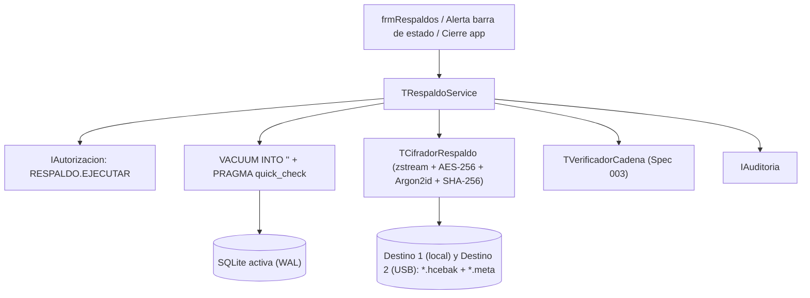

# Plan técnico 007 — Respaldo y Recuperación (SQLite)

Ref: [spec.md](spec.md) · ADR-001, ADR-002, ADR-004 · Constitución Art. 1, 2, 10

## 1. Arquitectura



## 2. Unidades Pascal

| Unidad | Contenido |
|---|---|
| `src/respaldos/uMetadataRespaldo.pas` | `TMetadataRespaldo` (serialización JSON `.meta`: fecha UTC, `user_version`, `ultimo_seq`, `ultimo_hash`, `sha256_db`, `sal_hex`) |
| `src/respaldos/uCifradorRespaldo.pas` | Compresión streaming (`TCompressionStream` de unidad estándar `zstream`) + cifrado por bloques AES-256-CBC + HMAC-SHA256 (Encrypt-then-MAC) con clave derivada vía Argon2id (`HashLib4Pascal`) |
| `src/servicios/uRespaldoService.pas` | `EjecutarRespaldo`, `EjecutarSiTocaAutomatico`, `AplicarRetencion`, `SimulacroRestauracion`, `Restaurar`, `EstadoSaludRespaldos` |
| `src/ui/ufrmRespaldos.pas/.lfm` | Pantalla de configuración de rutas, historial de respaldos, botones Respaldar / Simulacro / Restaurar |
| `tests/TestCifradorRespaldo.pas`, `TestRespaldoService.pas` | FPCUnit |

## 3. Modelo de datos (SQLite STRICT)

```sql
CREATE TABLE config_respaldo (
  id                     INTEGER PRIMARY KEY CHECK (id = 1),
  ruta_local             TEXT    NOT NULL,
  ruta_externa           TEXT,
  clave_verificacion_phc TEXT    NOT NULL,          -- hash Argon2id para validar frase antes de respaldar
  ultimo_respaldo_utc    TEXT,
  ultimo_externo_utc     TEXT,
  ultimo_simulacro_utc   TEXT,
  auto_al_cerrar         INTEGER NOT NULL DEFAULT 1 CHECK (auto_al_cerrar IN (0,1))
) STRICT;

CREATE TABLE historial_respaldos (
  id          INTEGER PRIMARY KEY,
  fecha_utc   TEXT    NOT NULL,
  archivo     TEXT    NOT NULL,
  tamano_bytes INTEGER NOT NULL,
  sha256_db   TEXT    NOT NULL CHECK (length(sha256_db) = 64),
  ultimo_seq  INTEGER NOT NULL,
  copia_ext   INTEGER NOT NULL CHECK (copia_ext IN (0,1)),
  tipo        TEXT    NOT NULL CHECK (tipo IN ('MANUAL','AUTO','PRE_RESTORE','SIMULACRO')),
  resultado   TEXT    NOT NULL CHECK (resultado IN ('OK','ERROR')),
  detalle     TEXT
) STRICT;
```

## 4. Decisiones técnicas (bajo consumo de RAM)
1. **`VACUUM INTO`**: disponible desde SQLite 3.27. Crea una copia limpia, compactada y transaccionalmente consistente a partir de una BD en modo WAL sin bloquear lectores y sin copiar páginas libres.
2. **Streaming en bloques de 64 KB**: tanto la compresión (`zstream`), el cálculo de `SHA-256` como el cifrado AES-256 operan por buffers de 64 KB sobre `TFileStream` → respaldar una BD de 500 MB consume **< 2 MB de RAM** (cumple Constitución Art. 10).
3. **Autenticación del paquete (Encrypt-then-MAC)**: de la frase + sal (16 B) se derivan 64 bytes con Argon2id: 32 B para clave AES-256 y 32 B para clave `HMAC-SHA256` sobre el archivo cifrado. Antes de intentar descifrar o descomprimir, se verifica el HMAC en streaming.

## 5. Pruebas
- Unitarias: `TCifradorRespaldo` (ida y vuelta archivo de prueba → hash idéntico; 1 bit alterado en `.hcebak` → detectado por HMAC; frase errónea → rechazada).
- Integración SQLite: crear BD con datos y cadena de auditoría → `EjecutarRespaldo` → modificar BD activa → `SimulacroRestauracion` verifica copia → `Restaurar` recupera estado anterior y agrega evento `RESTAURACION` válido en la cadena.

